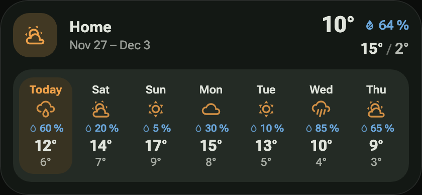
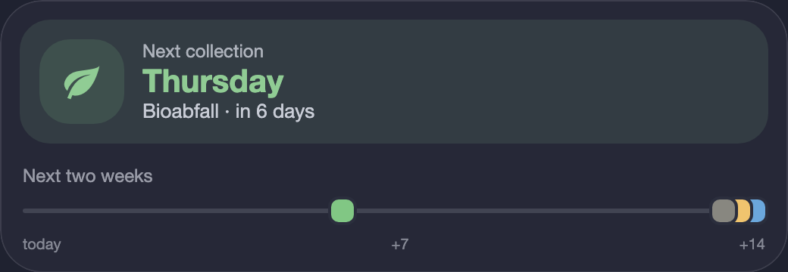
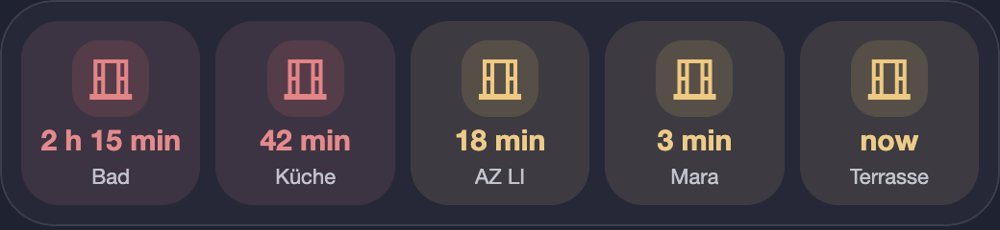
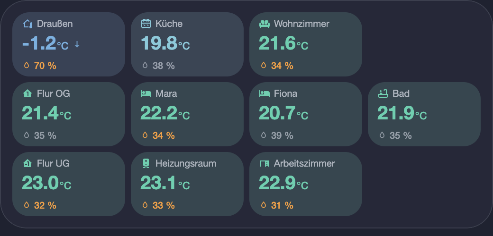
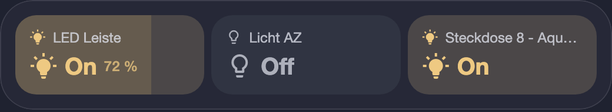

# HA M3 Cards

Material 3–style custom cards for Home Assistant dashboards, in one repository.
Each card lives in its own folder with its own docs, screenshots and source.

| Card | Folder | Type |
|---|---|---|
| [M3 Slim Weekly Weather](#m3-slim-weekly-weather) | [`ha-m3-slim-weekly-weather/`](ha-m3-slim-weekly-weather/) | `custom:m3-weather-card-week` |
| [M3 Slim Energy Card](#m3-slim-energy-card) | [`ha-m3-slim-energy-card/`](ha-m3-slim-energy-card/) | `custom:m3-slim-energy-card` |
| [M3 Slim Trash Card](#m3-slim-trash-card) | [`ha-m3-slim-trash-card/`](ha-m3-slim-trash-card/) | `custom:m3-slim-trash-card` |
| [M3 Slim Battery Card](#m3-slim-battery-card) | [`ha-m3-slim-battery-card/`](ha-m3-slim-battery-card/) | `custom:m3-slim-battery-card` |
| [M3 Slim Open Windows Card](#m3-slim-open-windows-card) | [`ha-m3-slim-open-windows/`](ha-m3-slim-open-windows/) | `custom:m3-slim-open-windows-card` |
| [M3 Slim Temperature Card](#m3-slim-temperature-card) | [`ha-m3-slim-temperature-card/`](ha-m3-slim-temperature-card/) | `custom:m3-slim-temperature-card` |
| [M3 Slim Lights Card](#m3-slim-lights-card) | [`ha-m3-slim-lights-card/`](ha-m3-slim-lights-card/) | `custom:m3-slim-lights-card` |

All cards ship in one file, `ha-m3-cards.js`: one install, one dashboard
resource.

All follow the design language of [j0sp0r/m3-cards](https://github.com/j0sp0r/m3-cards)
(MIT): 28px card radius, frosted surface, squircle icon wells, the m3 palette.
They work in light and dark themes.

## Installation

### HACS (recommended)

[](https://my.home-assistant.io/redirect/hacs_repository/?owner=koehntopp&repository=ha-m3-cards&category=plugin)

The repository is not in the default HACS store, so add it once as a custom
repository:

1. HACS → menu (⋮) top right → *Custom repositories*
2. URL `https://github.com/koehntopp/ha-m3-cards`, type **Dashboard** → *Add*
3. Search for "HA M3 Cards", open it, *Download*
4. Reload the browser

HACS registers the resource `/hacsfiles/ha-m3-cards/ha-m3-cards.js` itself.
If you had `m3-cards.js` or `m3-slim-energy-card.js` from the old
repositories as resources, remove them: the cards would be defined twice.

### Manual

1. Download `ha-m3-cards.js` from the [latest release](../../releases/latest)
2. Copy it to `config/www/ha-m3-cards.js`
3. *Settings → Dashboards → ⋮ → Resources → Add resource*, URL
   `/local/ha-m3-cards.js`, type *JavaScript module*
4. Reload the browser

### Building from source

```bash
./scripts/build.sh    # → dist/ha-m3-cards.js
```

It builds the weather card (`ha-m3-slim-weekly-weather/`, TypeScript + Lit, needs
Node 20+) and appends the energy, trash, battery, open-windows, temperature and lights cards (plain JS, no build).
Publishing a GitHub release runs the same script and attaches the
file to the release.

## M3 Slim Weekly Weather

The whole week in one row: weekday, condition, rain chance, high and low per
day, with today highlighted (`layout: row`).



Or one row per day, with a bar from the day's low to its high (`layout: list`):


- Bars share one scale across the week and are coloured by temperature (blue
  at 0 °C to red from 30 °C).
- Today is tinted; a dot on its bar marks the current temperature.
- `layout: row` compresses the week into one strip for phone dashboards.
- Own sensors (e.g. a weather station): current temperature and humidity in
  the header, own high/low; the weather entity fills in while they are
  unavailable.
- Reads the `daily` forecast via `weather.get_forecasts` from any `weather.*`
  entity (Met.no works without an API key), refreshed every 15 minutes.

```yaml
type: custom:m3-weather-card-week
entity: weather.forecast_home
layout: row                  # row | list
days: 7
sensors:                     # optional
  temperature: sensor.garden_temperature
  humidity: sensor.garden_humidity
  high: sensor.garden_temp_max
  low: sensor.garden_temp_min
```

Full options, colours and development notes:
[`ha-m3-slim-weekly-weather/README.md`](ha-m3-slim-weekly-weather/README.md).

## M3 Slim Energy Card

A compact energy overview: solar, battery, grid, home, heat pump, EV or any
other power sensor, as tiles (three per row) or as one row per device.


- Live power in kW per device, coloured by direction: green producing or
  exporting, red consuming or charging. Configurable and invertible per device.
- Second line with daily kWh, battery state of charge or grid price.
- Fill bar behind each tile: solar as share of `peak_kw`, battery as state of
  charge, everything else relative to the largest value on the card.
- Header with title, source count, grid price and home consumption.
- Visual editor: reorder, copy, remove, disable devices, pick the layout.

```yaml
type: custom:m3-slim-energy-card
layout: tiles                # tiles | rows
title: Energy
entities:
  - type: solar
    entity: sensor.solar_power
    daily_entity: sensor.solar_energy_today
    peak_kw: 10
  - type: battery
    entity: sensor.battery_power
    soc_entity: sensor.battery_soc
  - type: grid
    entity: sensor.grid_power
    price_entity: sensor.electricity_price
  - type: home
    entity: sensor.house_power
```

All device options and migration notes from `slim-energy-card`:
[`ha-m3-slim-energy-card/README.md`](ha-m3-slim-energy-card/README.md).

## M3 Slim Trash Card

The next bin collection and a timeline of the coming two weeks.



- Hero with the next pickup: weekday (or days, or date), bin name, today and
  tomorrow as words; bins on the same day are named together.
- Timeline with one marker per bin, same-day bins stacked, 7–28 days.
- Sensors give days until collection or the date itself, or one Waste
  Collection Schedule sensor (`details_format: upcoming`) covers all bins.
  Icons and colours follow the bin's name.

```yaml
type: custom:m3-slim-trash-card
entities:
  - sensor.bioabfall
  - sensor.restmuell
  - sensor.gelber_sack
  - sensor.papier
```

All options: [`ha-m3-slim-trash-card/README.md`](ha-m3-slim-trash-card/README.md).

## M3 Slim Battery Card

The weakest batteries below a threshold, in one row.


- Up to five batteries (configurable), lowest first: icon, level and name.
- Yellow below `threshold` (30 %), red at or below `critical` (15 %).
- Finds every sensor with device class battery; names come from the device.
- Nothing low: one line "All batteries above 30 %", or `hide_when_ok: true`.

```yaml
type: custom:m3-slim-battery-card
threshold: 30
critical: 15
count: 5
exclude:
  - sensor.pixel_*           # wildcards allowed
```

All options: [`ha-m3-slim-battery-card/README.md`](ha-m3-slim-battery-card/README.md).

## M3 Slim Open Windows Card

The open windows and doors in one row, with how long each has been open.



- Up to five (configurable), longest open first: icon, time open
  and name.
- Yellow while open, red after `alert_after` minutes (30).
- Finds window and door sensors by device class (garage doors optional);
  names come from the device without vendor and "Fensterkontakt"/"Window".
- Everything closed: one line "All windows and doors closed", or `hide_when_ok: true`.

```yaml
type: custom:m3-slim-open-windows-card
alert_after: 30
count: 5
```

All options: [`ha-m3-slim-open-windows/README.md`](ha-m3-slim-open-windows/README.md).

## M3 Slim Temperature Card

Room temperatures as slim tiles, as tall as the energy card's.



- Tiles with name, temperature, trend arrow and humidity; coloured like the
  m3 climate overview (blue cold, green comfortable, red hot).
- Four tiles to a row; a `separator` entry ends the row, so rows hold one to
  four tiles of the same width.
- `outdoor: true` colours a tile on the weather scale. Humidity outside
  35–65 % shows orange; names and icons come from the area.

```yaml
type: custom:m3-slim-temperature-card
entities:
  - entity: sensor.outdoor_temperature
    outdoor: true
  - sensor.kitchen_temperature
  - separator
  - sensor.bathroom_temperature
```

All options: [`ha-m3-slim-temperature-card/README.md`](ha-m3-slim-temperature-card/README.md).

## M3 Slim Lights Card

One to four lights in one row: tap toggles, drag sideways dims.



- Tiles as tall as the energy card's; the fill behind each tile shows the
  brightness and follows a sideways drag.
- Long press opens the more-info dialog; switches toggle too.
- On: yellow, or the light's own colour.

```yaml
type: custom:m3-slim-lights-card
entities:
  - light.led_leiste
  - light.licht_az
  - entity: switch.steckdose_8
    name: Aqualicht AZ
```

All options: [`ha-m3-slim-lights-card/README.md`](ha-m3-slim-lights-card/README.md).

## History

The folders were imported with `git subtree` from the former repositories
`koehntopp/m3-weather-card-week` and `koehntopp/ha-m3energy`; their commit
history is preserved here (folders since renamed to `ha-m3-slim-weekly-weather` and `ha-m3-slim-energy-card`).

## License

MIT — see [`LICENSE`](LICENSE).
