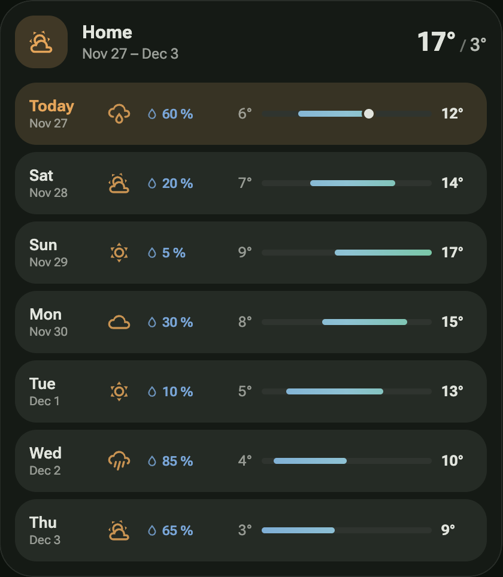
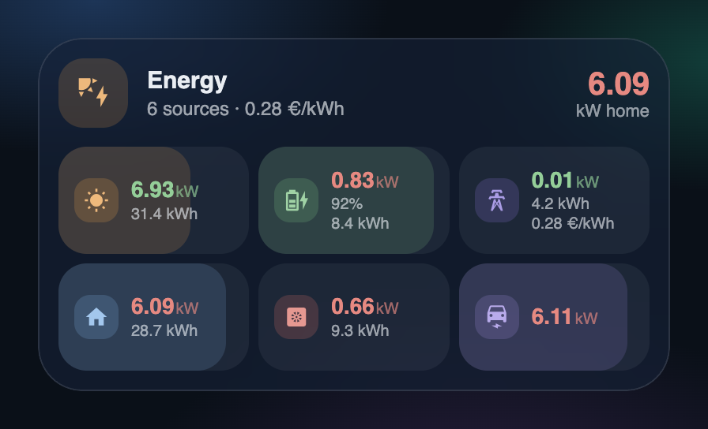

# HA M3 Cards

Material 3–style custom cards for Home Assistant dashboards, in one repository.
Each card lives in its own folder with its own docs, screenshots and source.

| Card | Folder | Type | Resource file |
|---|---|---|---|
| [M3 Weather Card Week](#m3-weather-card-week) | [`m3-weather-card-week/`](m3-weather-card-week/) | `custom:m3-weather-card-week` | `m3-cards.js` (TypeScript + Lit, built) |
| [M3 Slim Energy Card](#m3-slim-energy-card) | [`ha-m3energy/`](ha-m3energy/) | `custom:m3-slim-energy-card` | `m3-slim-energy-card.js` (plain JS, no build) |

Both follow the design language of [j0sp0r/m3-cards](https://github.com/j0sp0r/m3-cards)
(MIT): 28px card radius, frosted surface, squircle icon wells, the m3 palette.
They work in light and dark themes.

## Installation

The cards are installed as dashboard resources. Download the files from the
[latest release](../../releases/latest), or build them from this repository.

1. Copy the file to `config/www/` on your Home Assistant:
   - weather: `m3-cards.js`
   - energy: `m3-slim-energy-card.js`
2. *Settings → Dashboards → ⋮ → Resources → Add resource*, URL
   `/local/m3-cards.js` (or `/local/m3-slim-energy-card.js`), type
   *JavaScript module*. One resource per card.
3. Reload the browser, then add the card from the card picker or in YAML.

After an update, replace the file and reload the browser (clear the cache if
the old version sticks; appending `?v=2` to the resource URL forces it).

### Building from source

```bash
# weather card → m3-weather-card-week/dist/m3-cards.js
cd m3-weather-card-week
npm ci
npm run build

# energy card: nothing to build, use ha-m3energy/m3-slim-energy-card.js as is
```

## M3 Weather Card Week

The week at a glance: one row per day with condition, rain chance, a bar from
the day's low to its high and the date, or all days side by side in one row.



- Bars share one scale across the week and are coloured by temperature (blue
  at 0 °C to red from 30 °C).
- Today is tinted; a dot on its bar marks the current temperature.
- `layout: row` compresses the week into one strip for phone dashboards.
- Own sensors (e.g. a weather station) can replace the header high/low and the
  current temperature; the forecast fills in while they are unavailable.
- Reads the `daily` forecast via `weather.get_forecasts` from any `weather.*`
  entity (Met.no works without an API key), refreshed every 15 minutes.

```yaml
type: custom:m3-weather-card-week
entity: weather.forecast_home
layout: list                 # list | row
days: 7
sensors:                     # optional
  temperature: sensor.garden_temperature
  high: sensor.garden_temp_max
  low: sensor.garden_temp_min
```

The bundle is a fork of j0sp0r/m3-cards with this card added; it also registers
the upstream M3 cards. Full options, colours and development notes:
[`m3-weather-card-week/README.md`](m3-weather-card-week/README.md).

## M3 Slim Energy Card

A compact energy overview: solar, battery, grid, home, heat pump, EV or any
other power sensor, as tiles (three per row) or as one row per device.



- Live power in kW per device, coloured by direction: green producing or
  exporting, red consuming or charging. Configurable and invertible per device.
- Second line with daily kWh, battery state of charge or grid price.
- Fill bar behind each tile: solar as share of `peak_kw`, battery as state of
  charge, everything else relative to the largest value on the card.
- Header with title, source count, grid price and home consumption.
- Visual editor: reorder, copy, remove, disable devices, pick the layout.

```yaml
type: custom:m3-slim-energy-card
layout: tiles                # tiles | rows
title: Energy
entities:
  - type: solar
    entity: sensor.solar_power
    daily_entity: sensor.solar_energy_today
    peak_kw: 10
  - type: battery
    entity: sensor.battery_power
    soc_entity: sensor.battery_soc
  - type: grid
    entity: sensor.grid_power
    price_entity: sensor.electricity_price
  - type: home
    entity: sensor.house_power
```

All device options and migration notes from `slim-energy-card`:
[`ha-m3energy/README.md`](ha-m3energy/README.md).

## History

The folders were imported with `git subtree` from the former repositories
`koehntopp/m3-weather-card-week` and `koehntopp/ha-m3energy`; their commit
history is preserved here.

## License

MIT — see the `LICENSE` file in each card's folder.
