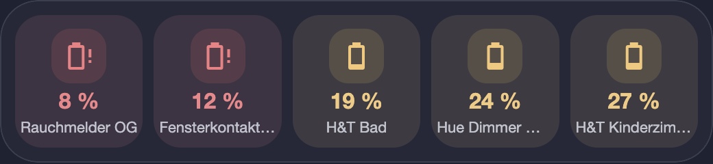

# M3 Slim Battery Card

The weakest batteries below a threshold, in one row, in the Material 3 look
of [j0sp0r/m3-cards](https://github.com/j0sp0r/m3-cards).



- **One row**: up to `count` batteries below `threshold`, lowest first. Each
  shows a battery icon, the level and the name.
- **Colours**: yellow below the threshold, red at or below `critical`, with a
  warning icon.
- **Discovery**: every `sensor.*` with device class battery and unit `%`, or
  only the ones listed in `entities`. Unavailable sensors are skipped.
- **Names**: the device's name (many battery sensors are just called
  "Battery"), without a trailing "Battery", "Batterie" or "Akku".
- **All fine**: one line "All batteries above 30 %", or the card hides itself
  with `hide_when_ok: true`.
- Tap a battery for its details. Visual editor; English and German.

## Installation

Part of [HA M3 Cards](../README.md#installation): install `ha-m3-cards.js`
once, all cards come with it.

## Configuration

```yaml
type: custom:m3-slim-battery-card
threshold: 30
critical: 15
count: 5
exclude:
  - sensor.pixel_*           # * matches any characters
  - sensor.fordpass_*
```

| Option | Default | Description |
|---|---|---|
| `threshold` | `30` | Show batteries below this level (%) |
| `critical` | `15` | Red at or below this level (%) |
| `count` | `5` | Most batteries in the row |
| `entities` | all | Only these battery sensors |
| `exclude` | none | Battery sensors never shown (phones, cars); `*` is a wildcard, e.g. `sensor.pixel_*` (YAML only, the visual editor picks single entities) |
| `hide_when_ok` | `false` | Hide the card when no battery is below the threshold |

`preview.html` shows the card with made-up batteries
(`python3 -m http.server`, then open `/preview.html`).

## License

MIT, see [LICENSE](LICENSE). Design after j0sp0r/m3-cards (MIT).
