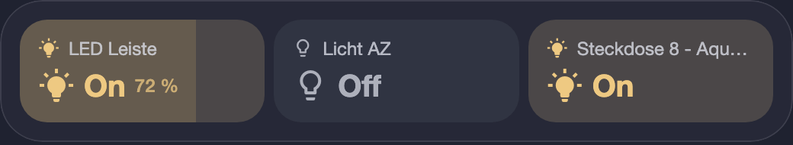

# M3 Slim Lights Card

One to four lights or switches as tiles in one row, as tall as the energy
card's tiles.



- **Tap** toggles the light.
- **Drag sideways** sets the brightness (dimmable lights only); the fill
  behind the tile follows your finger and shows the brightness.
- **Long press** opens the more-info dialog.
- On: tinted yellow, or in the light's own colour if it has one. The state
  reads On/Off (An/Aus in German) with the brightness next to it.
- Switches (`switch.*`) toggle like on/off lights.

```yaml
type: custom:m3-slim-lights-card
entities:
  - light.led_leiste
  - light.licht_az
  - entity: switch.steckdose_8
    name: Aqualicht AZ
    icon: mdi:fishbowl-outline
```

| Option | Default | |
|---|---|---|
| `entities` | — | One to four lights or switches: an entity ID, or `{ entity, name, icon }` |

Name and icon default to the entity's friendly name and icon.

## Preview

`preview.html` runs the card against a mocked `hass` (serve the folder, e.g.
`python3 -m http.server`); taps and drags change the mock lights.

## License

MIT
