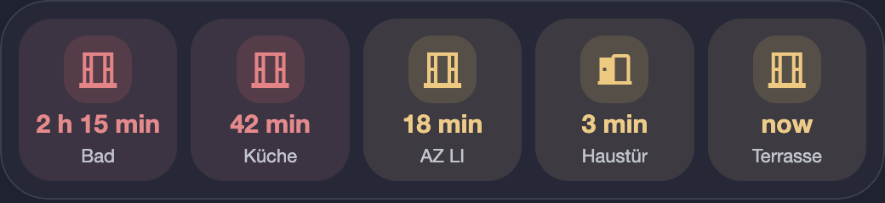

# M3 Slim Open Windows Card

The open windows and doors in one row, longest open first, in the Material 3 look of
[j0sp0r/m3-cards](https://github.com/j0sp0r/m3-cards).



- **One row**: up to `count` open windows. Each shows an icon, how long it
  has been open ("now", "18 min", "2 h 15 min", "3 d 4 h") and the name.
- **Colours**: yellow while open, red once open for `alert_after` minutes.
- **Discovery**: every `binary_sensor.*` with device class window or door, or
  the classes in `device_classes` (window, door, garage_door, opening), or
  only the sensors in `entities`.
- **Names**: the device's name without vendor and sensor words ("Shelly
  Fensterkontakt Bad" → "Bad"; Shelly, Aqara, Xiaomi, Hue, IKEA, Tuya,
  Sonoff, Homematic, Eve, Fenster, Fensterkontakt, Window, Door, Kontakt,
  Contact, Sensor, Opening) and without a bracketed part at the end.
- **All closed**: one line "All windows and doors closed", or the card hides itself
  with `hide_when_ok: true`.
- Tap a window for its details. Durations update every 30 seconds. Visual
  editor; English and German.

## Installation

Part of [HA M3 Cards](../README.md#installation): install `ha-m3-cards.js`
once, all cards come with it.

## Configuration

```yaml
type: custom:m3-slim-open-windows-card
alert_after: 30
count: 5
device_classes: [window, door, garage_door]
exclude:
  - binary_sensor.garage_*     # * matches any characters
```

| Option | Default | Description |
|---|---|---|
| `alert_after` | `30` | Red once open this many minutes |
| `count` | `5` | Most windows in the row |
| `device_classes` | `[window, door]` | Sensor types to look for |
| `entities` | all | Only these binary sensors |
| `exclude` | none | Sensors never shown. `*` is a wildcard; a pattern without a domain matches the part after `binary_sensor.`. The visual editor has a separate field for patterns |
| `closed_text` | "All windows and doors closed" | Text when nothing is open |
| `hide_when_ok` | `false` | Hide the card when nothing is open |

`preview.html` shows the card with made-up windows
(`python3 -m http.server`, then open `/preview.html`).

## License

MIT, see [LICENSE](LICENSE). Design after j0sp0r/m3-cards (MIT).
