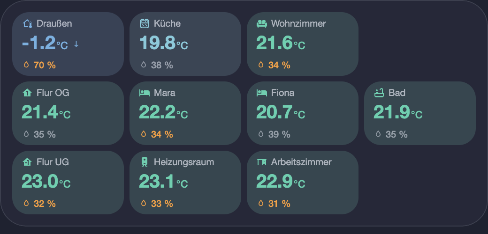

# M3 Slim Temperature Card

Room temperatures as slim tiles, as tall as the
[energy card's](../ha-m3-slim-energy-card/), in the Material 3 look of
[j0sp0r/m3-cards](https://github.com/j0sp0r/m3-cards). A slim take on its
climate overview card.



- **Tiles**: icon and name, temperature (with a trend arrow), humidity. 68px
  high, the same as the energy card's tiles.
- **Rows**: four tiles to a row (`columns`). A `separator` entry ends the row,
  so rows can hold one, two, three or four tiles and every tile keeps the
  same width.
- **Colours** as in the climate overview: blue below 19 °C, teal below
  20.5 °C, green to 23.5 °C, yellow to 25 °C, red above. `outdoor: true`
  colours a tile on the weather scale instead (0 °C blue … 30 °C red,
  blended).
- **Humidity**: orange outside 35–65 % (`humidity_range`), else muted. Taken
  from the humidity sensor on the same device unless one is set.
- **Trend**: an arrow when the temperature moved more than 0.5 K in the last
  hour (`show_trend: false` turns it off).
- **Names and icons** default to the sensor's area; else the friendly name
  without "Temperature".
- Tap a tile for the temperature's details, the humidity line for the
  humidity's. Visual editor with rooms, line breaks, reordering.

## Installation

Part of [HA M3 Cards](../README.md#installation): install `ha-m3-cards.js`
once, all cards come with it.

## Configuration

```yaml
type: custom:m3-slim-temperature-card
entities:
  - entity: sensor.outdoor_temperature
    name: Draußen
    outdoor: true
  - sensor.kitchen_temperature
  - sensor.living_room_temperature
  - separator
  - entity: sensor.bathroom_temperature
    humidity_entity: sensor.bathroom_humidity
    icon: mdi:bathtub-outline
```

| Option | Default | Description |
|---|---|---|
| `entities` | required | Temperature sensors (an entity ID or an object) and `separator` entries |
| `columns` | `4` | Tiles per row; a separator ends a row early |
| `humidity_range` | `[35, 65]` | Humidity outside this range shows orange |
| `show_trend` | `true` | Arrow for more than 0.5 K change in the last hour |

Per entity:

| Option | Default | Description |
|---|---|---|
| `entity` | required | Temperature sensor |
| `humidity_entity` | same device | Humidity sensor; `""` for none |
| `name` | area name | Tile name |
| `icon` | area icon | Tile icon |
| `outdoor` | `false` | Colour on the weather scale instead of the room stages |

`preview.html` shows the card with made-up rooms next to the energy card
(`python3 -m http.server` in the repository root, then open
`/ha-m3-slim-temperature-card/preview.html`).

## License

MIT, see [LICENSE](LICENSE). Design after j0sp0r/m3-cards (MIT).
