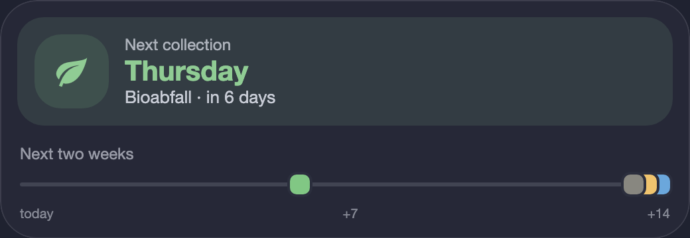

# M3 Slim Trash Card

The next bin collection and a timeline of the coming days, in the Material 3
look of [j0sp0r/m3-cards](https://github.com/j0sp0r/m3-cards). A slim
version of its waste card: just the hero and the timeline, no per-bin list,
no reminder mode.



- **Hero**: the next pickup's bin, its weekday (or the days, or the date) and
  the bin's name. Today and tomorrow are words. Several bins on the same day
  are named together; `hero_icon: multi` overlaps their icons.
- **Timeline**: one marker per bin over the next two weeks (7–28 days).
  Bins on the same day stack, and a group at the end stays inside the track.
  Collections beyond the span are left out instead of piling up at the end.
- **Sensors**: state is the number of days until collection (e.g. Waste
  Collection Schedule with `value_template: '{{ value.daysTo }}'`) or the date
  itself (`2026-12-03` or a timestamp).
- Names lose the device name in front (often the street address). Icon and
  colour come from the name: paper, bio, residual, recycling/yellow bag,
  glass, bulky waste, in German, English, French and Dutch; any bin can set
  its own.
- Tap the hero or a marker for the bin's more-info dialog.
- English and German, plain JS, no build, visual editor.

## Install

See [Installation](../README.md#installation) in the repository README.

## Configuration

```yaml
type: custom:m3-slim-trash-card
entities:
  - sensor.bioabfall
  - sensor.restmuell
  - sensor.gelber_sack
  - entity: sensor.papier
    name: Paper
    icon: mdi:package-variant
    color: "#6ba7dc"
hero_primary: weekday     # weekday (default) | days | date
```

| option | default | |
|---|---|---|
| `entities` | — | sensors: id, or `{ entity, name, icon, color }` |
| `hero_primary` | `weekday` | what leads: `weekday` ("Thursday"), `days` ("In 6 days"), `date` ("3 Dec"); the other goes underneath |
| `hero_icon` | `first` | `first`: one icon; `multi`: all bins of that day, overlapping |
| `title` | "Next collection" | label above the hero's main line |
| `show_timeline` | `true` | `false` keeps only the hero |
| `timeline_days` | `14` | timeline span, 7–28 |
| `timeline_title` | "Next two weeks" | label above the timeline |

## License
MIT
