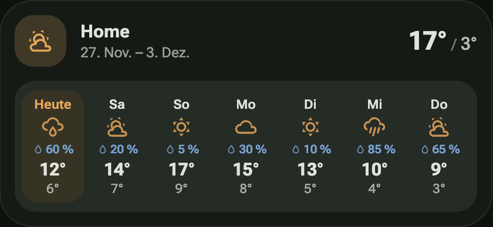
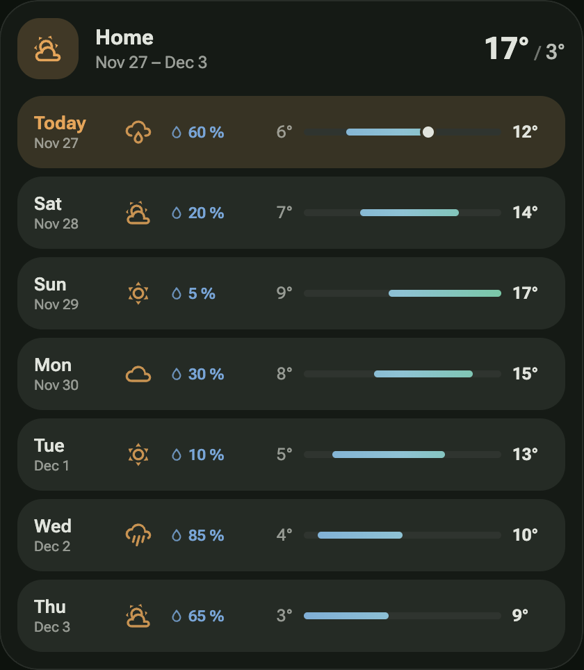

# M3 Slim Weekly Weather

A Material 3 weekly forecast card for Home Assistant — the week at a glance,
one row per day or all seven days in a single row.



<details open>
<summary>One row per day</summary>



</details>

- **One row per day**: condition, rain chance, a bar from that day's low to its
  high, both figures and the date.
- **Today** is tinted, and a dot on its bar marks where the current temperature
  sits inside the day's range.
- **`layout: row`** compresses the week into a strip of columns — a third of
  the height, for a phone dashboard.
- **Your own sensors** can replace the two figures in the header and the
  current reading behind the dot, e.g. from a weather station next door.
- Frosted-glass or solid surface, accent colours, corner radius and the
  Material motion the rest of the M3 suite uses.

## Installation

See [Installation](../README.md#installation) in the repository README.

## Usage

```yaml
type: custom:m3-weather-card-week
entity: weather.forecast_home
```

The card reads the `daily` forecast through `weather.get_forecasts` and
refreshes it every 15 minutes — it does not generate weather data of its own.
If you have no `weather.*` entity yet, the free, built-in **Met.no**
integration needs no API key: *Settings → Devices & Services → Add Integration
→ "Met.no"*. How many days the integration delivers is up to the integration —
Met.no delivers 6 days max, so asking for 7 shows 6. An entity without a daily
forecast gets a short hint instead of an empty list.

Each day's bar is drawn on the week's shared scale, so the rows line up. Its
colour is the temperature itself, on a fixed outdoor scale: blue up to 0 °C,
cyan around 10 °C, green around 17 °C, yellow around 24 °C and red from 30 °C,
blended in between — a cold week stays blue, a hot one turns red.

### One row

```yaml
type: custom:m3-weather-card-week
entity: weather.forecast_home
layout: row
```

One column per day with the weekday, condition, rain chance, high and low.
The columns keep a minimum width: if there are more days than fit, the strip
scrolls sideways instead of squeezing them into unreadable slivers. On a
narrow card the rain chance is the first thing to go.

### Your own sensors

The forecast says 17°, your station says 15.4° — the two figures in the card's
top right come from the forecast by default. `sensors` takes your own instead.
`high` and `low` replace those two numbers; `temperature` replaces the reading
that marks "now" on today's bar. Each one falls back to the forecast's value
while its sensor is unavailable, so a dead battery never blanks the header.

```yaml
type: custom:m3-weather-card-week
entity: weather.home
sensors:
  temperature: sensor.garden_temperature
  high: sensor.garden_temp_max
  low: sensor.garden_temp_min
```

Sensors are shown as they read — pick ones in the same unit as the weather
entity, since the header prints degrees without converting.

## Configuration

| Option | Type | Default | Description |
|---|---|---|---|
| `entity` | string | – (required) | `weather` entity |
| `name` | string | entity's friendly name | Header title |
| `days` | number | `7` | Days shown, 1–14 (limited by what the integration delivers) |
| `layout` | `list` \| `row` | `list` | `list`: one row per day. `row`: the days side by side in one row |
| `show_date` | boolean | `true` | The date under each weekday (list layout) |
| `show_precipitation` | boolean | `true` | Rain chance per day; hidden entirely when the integration has none |
| `show_wind` | boolean | `false` | Wind speed per day (list layout); hidden entirely when the integration has none |
| `show_summary` | boolean | `false` | Adds the average-high/low and precipitation strip under the week |
| `highlight_today` | boolean | `true` | Tints today's row/column and marks the current temperature |
| `decimals` | number | `0` | Decimal places of the temperatures, 0–2 |
| `sensors` | object | – | Own sensors: `temperature`, `high`, `low` |
| `tap_action` | action | `more-info` | Tap on the header |
| `accent_color` | string | solar yellow | Today's tint, the icon well and the "now" dot |
| `accent_opacity` | number | `18` | Strength of that tint, 0–100 |
| `precipitation_color` | string | `#6ba7dc` | The rain-chance column |
| `text_color` / `secondary_text_color` | string | theme default | Temperatures/day names vs. dates and secondary values |
| `card_background` | string | glass/solid background | Card background |
| `animation` | `auto` \| `on` \| `off` | `auto` | Rows fade in one after another; `auto`/`on` respect `prefers-reduced-motion` |
| `glass_background` | boolean | `true` | Frosted glass background |
| `radius` / `corners` | number / object | `28` | Corner radius, optional per corner |

## Building

```bash
npm ci
npm run build      # dist/m3-cards.js
npm run lint       # tsc --noEmit + eslint
npm test           # vitest
npm run dev        # rebuild on change; open demo/index.html on a local server
```

## Credits

The card is built on the shared kit of
[M3 Cards](https://github.com/j0sp0r/m3-cards) by j0sp0r — colour resolution,
glass frame, header, editor scaffolding and the temperature scale are theirs.
This repository carries only the week card; the other 59 cards live in the
upstream project.

MIT licensed.
